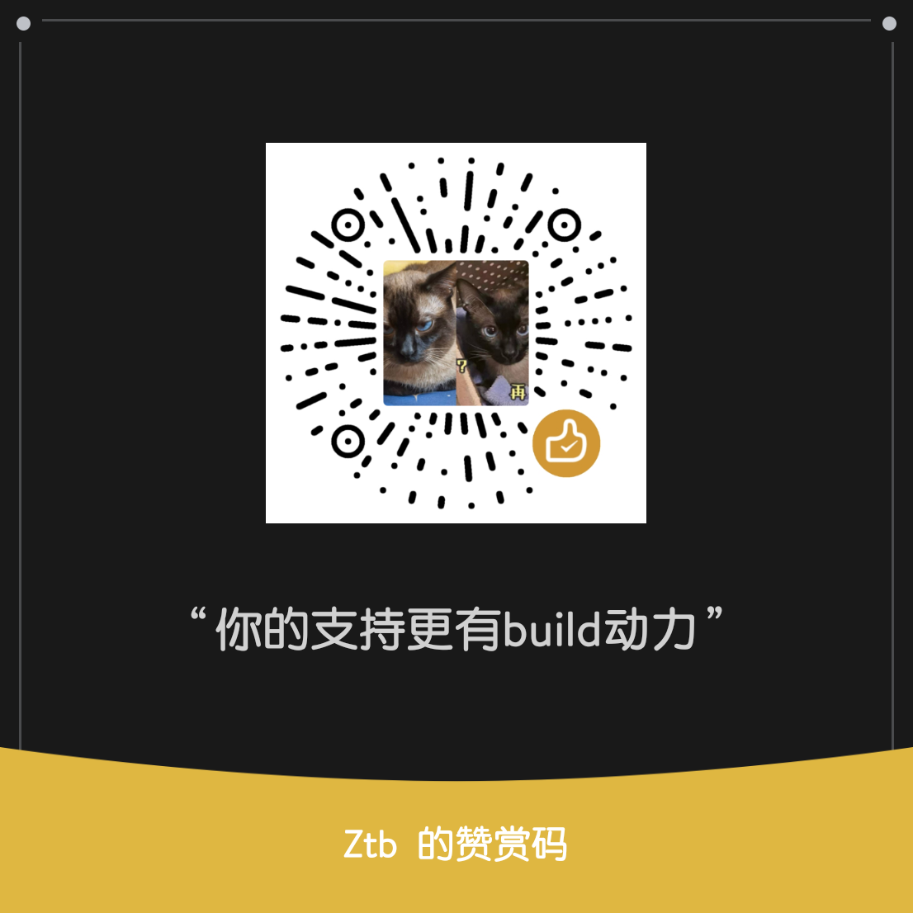

# ZtbWrt CI — Airoha AN758x PON 云编译
> 固件免费开源分享。如果帮你省了事、省了心，欢迎扫码支持一下 ☕ —— 您的每一份心意，都是本ID继续编译、持续更新的动力
>
> 

---
基于 P3TERX `Actions-OpenWrt` 模板重构，源码指向 [pbs05/ponwrt](https://github.com/pbs05/ponwrt)（默认分支 `master`），
## 支持的机型

| SoC | profile |
|-----|---------|
| AN7581 | `fiberhome_hg5382a` `fiberhome_hg5585f-ct` `fiberhome_hg5585f-cu` `gemtek_xg2010g` `nokia_xg-040g-md-ubi` `nokia_xg-040g-tf-ubi` `unionman_ung00a` `znxt_zn504xg-d` `znxt_zn515xg-d` `h3c_hm2004-du` |
| AN7583 | `nokia_xg-040g-mf` `nokia_xg-040g-mf-ubi` |
| AN7581 | `bell_xg-140g-tf`（贝尔 XG-140G-TF 精简档，见下） |

### 贝尔 XG-140G-TF（AN7581）怎么选

贝尔 XG-140G-TF 与 Nokia XG-040G-TF 是**同一套参考设计**（AN7581 + EN7572 光前端 + EN8811H 2.5G），
上游 `pbs05/ponwrt` 里没有 140G 的 DTS，所以本仓库用**别名 profile** 处理：

| Actions 里选的 profile | 实际用的上游设备符号 | 产物名 |
|---|---|---|
| `bell_xg-140g-tf` | `nokia_xg-040g-tf-ubi` | `ponwrt-an7581-bell_xg-140g-tf-...` |

- 产物/Release 名字是 140G，`make` 用的是已实机验证过的 040G-TF 设备定义，**不需要改上游源码**；
- 开机后 LuCI 概览页显示的机型仍是 `Nokia XG-040G-TF (UBI)`（设备树里的 model 字符串），属正常现象；
- **引导必须用 TF 专用的**：TF 面板机型芯片烧了安全启动密钥，`BL2 / U-Boot / FIP` 要用 `pbs05/uboot-an758x` 的 `xg-040g-tf` target（或 `pbs05/an758x-stock2ubi` 免拆流程）。本仓库只产出系统镜像，不产出引导；
- 迁移前备份原厂 `all_flash` / `bootloader`，PON 注册依赖原厂 `bosa`（校准）与 `ri`（SN/MAC）分区。

### 精简档 `bell_xg-140g-tf` 装了什么

配套配置文件 `configs/bell_xg-140g-tf.config`，只保留「拨号能正常上网」所需 + 两个额外功能：

| 分类 | 内容 |
|---|---|
| 拨号 | PON 驱动（`kmod-airoha-xpon` / `pon-frontend` / `en7572`）、`airoha-pond` / `ponctl`、PPPoE（`ppp` + `ppp-mod-pppoe`）、`netifd`、`dnsmasq-full`、`firewall4` + nftables、IPv6 |
| 管理 | LuCI 基础（`luci-mod-*`、`luci-app-firewall`、`luci-app-pon`、软件包页）+ 简体中文 |
| 代理 | **OpenClash**（`luci-app-openclash`，来源 [vernesong/OpenClash](https://github.com/vernesong/OpenClash) dev 分支，由 `diy-part1.sh` 拉取）。依赖 `ruby`，首次冷编译约多 10~20 分钟 |
| 网络唤醒 | `luci-app-wol` + `etherwake`（`网络 → Wake-on-LAN`） |
| 已精简 | WiFi 整栈、USB/外置存储栈、IPTV（`luci-app-iptv` / `rtp2httpd`）、PON 状态页、NAT 类型选择、NPU 状态页、`tcpdump` / `iperf3` / `i2c-tools` / `ethtool`、WireGuard/OpenVPN/PPTP 内核模块、`dae` / `honk` / `passwall` 等 |

两点使用提醒：

1. `proxy` 输入留空时，若机型配置里已经固定了 OpenClash（本档就是），workflow 会自动按 **openclash** 变体构建；
   想编一个不带代理的，把 `configs/bell_xg-140g-tf.config` 里 `CONFIG_PACKAGE_luci-app-openclash=y` 注释掉即可。
2. 要用 U 盘 / 想加回某个插件：删掉配置里对应的 `# CONFIG_PACKAGE_xxx is not set` 行，
   并在 `diy-part2.sh` 的 `LEAN_PLUGINS=1` 分支里补 `=y`。

## Release 4 个变体(强烈推荐 openclash和honk，openclash最简单好用，honk需要折腾一下)

- openclash版 https://github.com/vernesong/OpenClash
- dae版 https://github.com/daeuniverse/dae
- honk版 采用404大佬的库 感谢大佬 https://github.com/QiuSimons/luci-app-honk
- 啥都不带版

注意，本hub编译的404大佬的honk自带v2ray的geoip/site库（/user/share/v2ray/），在honk启动时候加入变量引入使用。

### AN7583 带硬解AES功能，AN7581带软解

## ☕ 赞赏支持

固件为**免费开源**分享。如果您觉得好用，欢迎扫码支持一杯咖啡，让ZTB有动力持续维护、继续编译更新。

